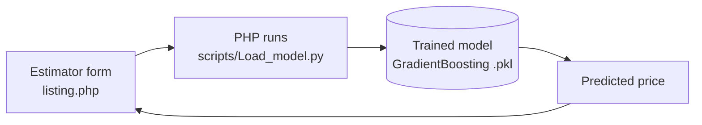

<h1 align="center">🚘 WisePrice</h1>

<p align="center">WisePrice website for car price prediction using machine learning (FYP).<br>
A PHP and MySQL used-car marketplace with a built-in price estimator and an admin panel.</p>

<p align="center">
  
  
  
  
  
</p>

<p align="center">
  <a href="#-features"><b>Features</b></a> ·
  <a href="#-how-the-price-prediction-works">Prediction</a> ·
  <a href="#-running-it-locally">Run locally</a> ·
  <a href="#-whats-in-the-archive">Contents</a>
</p>

---

> [!NOTE]
> The project is stored as a single archive, [`wiseprice.rar`](wiseprice.rar) (about 18 MB, including the sample car photos). Extract it to get the `wiseprice/` site folder.

## ✨ Features

| Area | What it does |
|---|---|
| **Price estimator** | A form (make, model, fuel type, transmission, registered city, color, assembly, body type, model year, mileage, engine capacity) that runs a trained model and returns a predicted price |
| **Car listings** | Browse and view cars with manufacturer, model, year, base price and photo |
| **Post a car** | Signed-in customers submit a listing with a picture, city, mileage, price and description. New posts start as **pending** |
| **Customer accounts** | Register and log in; passwords are stored hashed (`password_hash`) |
| **Admin panel** (`myadmin/`) | Admin login, dashboard totals (cars, manufacturers, users), **approve or deny pending posts**, list cars, profile and settings |
| **Contact form** | Messages are saved to the database |
| **Content pages** | About, services, FAQ, blog, gallery, team, reviews and special offers pages |

## 🤖 How the price prediction works



The model is a scikit-learn Gradient Boosting regressor (`scripts/best_car_price_predictor_GradientBoosting.pkl`). The training code and dataset live in the companion repository [Car-Price-Prediction](https://github.com/faizankhan789/Car-Price-Prediction), which picks the best of seven algorithms with Bayesian optimization and K-fold cross-validation.

## 🚀 Running it locally

Requires a PHP and MySQL stack (for example XAMPP or WAMP) and Python 3 with the model's libraries (pandas, scikit-learn, joblib).

1. Extract `wiseprice.rar` into your web root (for example `htdocs/`).
2. Create a MySQL database named `fyp`. `config.php` and `myadmin/config.php` connect to `localhost` as `root` with an empty password (the XAMPP defaults); change them if yours differ.
3. Create the tables the code uses: `manufacturers`, `cars`, `customers`, `users`, `contact_us` and `inventory`. The archive does not include a SQL schema file.
4. In `listing.php`, set the command that runs `Load_model.py` to your Python executable and to the path of `scripts/Load_model.py`.
5. Open `http://localhost/wiseprice/` in your browser. The admin panel is at `/wiseprice/myadmin/`.

## 📁 What's in the archive

```text
wiseprice/
  index.php, listing.php, car-details.php   home, price estimator, car details
  add-post.php, update.php, delete.php,
  view.php, list.php                        manage car listings
  contact-us.php, config.php                contact form, database connection
  myadmin/                                  admin login, dashboard, pending posts, settings
  scripts/                                  Load_model.py + trained model (.pkl)
  uploads/                                  car photos
  css/, js/, fonts/, *.html                 theme assets and static pages
```
